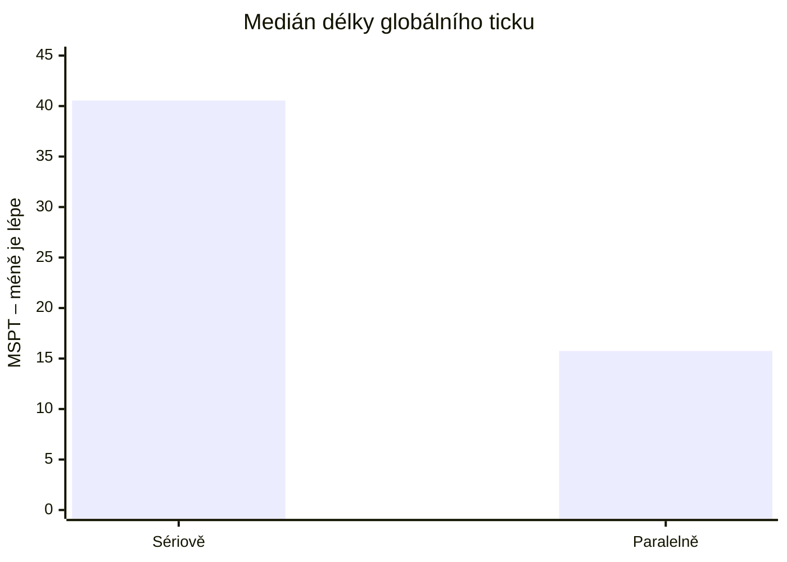
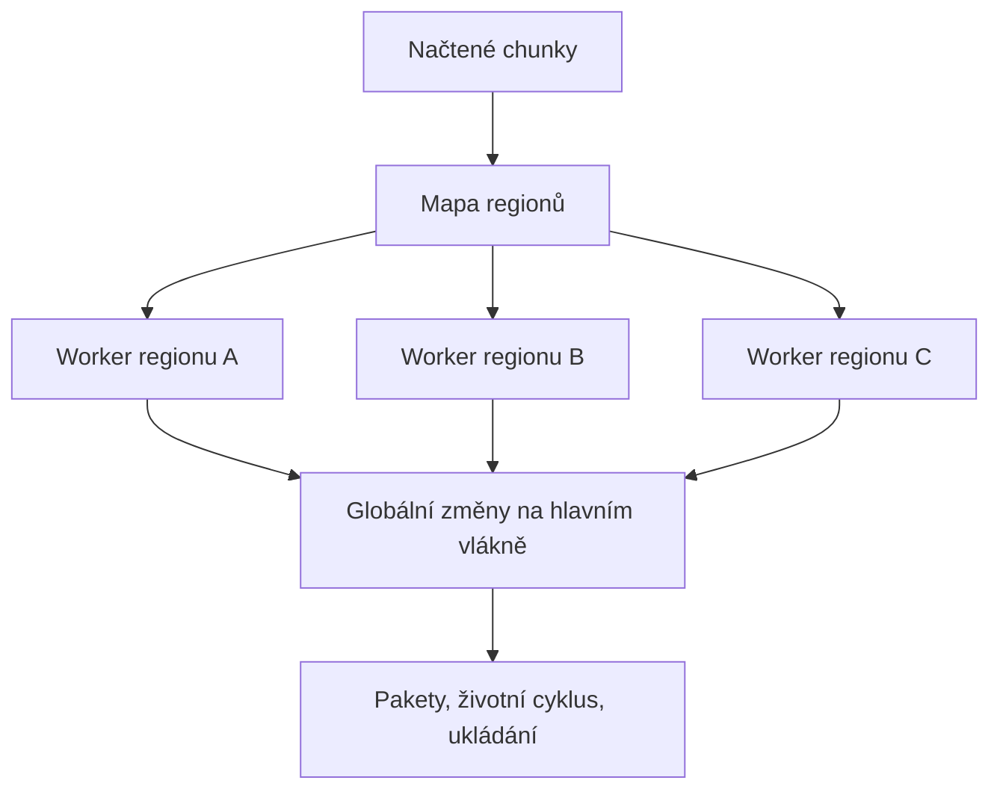

# Tessellate

[English](README.md) | **Čeština**

Tessellate je výkonnostní mód pro Fabric a NeoForge pro Minecraft 26.3. Seskupuje vzdálené načtené oblasti do nezávislých regionů a umožňuje jim běžet na různých jádrech CPU. Pokud jeden region začne vyžadovat příliš mnoho výpočetního času, může ho zpomalit, aniž by tím zpomalil zbytek serveru.

Podpora a diskuze: [Discord Tessellate](https://discord.gg/dPY6zmHtr5).

## Stažení

Buildy pro 26.3 stáhnete z [GitHub Actions](https://github.com/JanBenicek/Tessellate/actions/workflows/ci.yml) → úspěšný běh → **Artifacts**.
Vydané verze jsou také dostupné na [CurseForge](https://www.curseforge.com/minecraft/mc-mods/tessellate).

| Situace | Co Tessellate udělá |
| --- | --- |
| Několik vzdálených základen je zatížených | Spustí jejich regiony souběžně |
| Jeden region překročí rozpočet serveru | Sníží frekvenci simulace pouze v tomto regionu |
| Dva regiony se přiblíží natolik, že mohou vzájemně interagovat | Sloučí je před tickováním |
| Pracovní vlákno narazí na nebezpečný přístup ke sdílenému stavu | Přepne na sériové tickování do konce běhu serveru |

Největší přínos má mód tehdy, když jsou hráči nebo trvale načtené oblasti rozmístěné daleko od sebe. Jedna hustá základna, farma na moby nebo skupina strojů stále tvoří jeden region, takže tuto práci Tessellate nemůže rozdělit mezi několik jader. Nenahrazuje ani optimalizace jednoho vlákna, například [Lithium](https://modrinth.com/mod/lithium); řeší jiný problém.

## Benchmark pro Minecraft 1.21.1

Tyto výsledky pocházejí z původní verze pro 1.21.1 a nebyly zopakovány na 26.3.
Benchmark používal pořadí ABBA s restartem serveru před každým během. Test zahrnoval čtyři trvale načtené regiony vzdálené 2 048 bloků, každý s přesně 1 200 persistentními zombiemi (celkem 4 800). Oba režimy používaly adaptivní zpomalování a stejnou sestavu devíti módů. Měnila se pouze volba `parallelTicking`.



**Paralelní tickování snížilo medián MSPT o 61,2 % a 95. percentil MSPT o 62,5 %.** Ve všech čtyřech regionech se při obou paralelních bězích udrželo 20 TPS. Při sériových bězích musel adaptivní rozpočet některé regiony zpomalit, protože jejich práce mohla probíhat pouze postupně.

| Režim, medián dvou běhů | Medián MSPT | Medián p95 | Regiony na 20 TPS | Nejpomalejší region |
| --- | ---: | ---: | ---: | ---: |
| Sériové regionální tickování | 40,55 ms | 50,80 ms | 0/4 a 1/4 | 10,0–10,6 TPS |
| **Paralelní regionální tickování** | **15,75 ms** | **19,05 ms** | **4/4 v obou bězích** | **20,0 TPS** |

<details>
<summary>Jednotlivé běhy a podmínky benchmarku</summary>

| Běh | Medián MSPT | p95 MSPT | Regiony na 20 TPS | Nejpomalejší region |
| --- | ---: | ---: | ---: | ---: |
| Sériový A | 40,1 ms | 50,8 ms | 0/4 | 10,0 TPS |
| Paralelní A | 15,1 ms | 18,8 ms | 4/4 | 20,0 TPS |
| Paralelní B | 16,4 ms | 19,3 ms | 4/4 | 20,0 TPS |
| Sériový B | 41,0 ms | 50,8 ms | 1/4 | 10,6 TPS |

- Hardware: Intel Core Ultra 7 255H, 16 jader, Java 21.
- Prostředí: Minecraft 1.21.1, NeoForge 21.1.248, Lithium 0.15.4, C2ME 0.4.0-alpha.0.120, Mekanism a Mekanism Generators 10.7.19.85, Naturalist 2.0.3, Citadel 2.7.1, Friends & Foes 4.0.27, Resourceful Lib 3.0.12 a ScalableLux 0.3.0-alpha.0.8.
- Každý běh vynechal dvě osmivteřinová zahřívací okna a následně použil medián pěti osmivteřinových vzorků.
- V obou režimech bylo `asyncRegionLoops=false`, aby `tick query` zahrnovalo i čekání na pracovní vlákna. Výchozí asynchronní režim na ně nečeká v každém ticku, takže jeho MSPT hlavního vlákna nelze přímo srovnávat.
- Efektivní TPS regionů měřilo vanilla pole `ItemEntity.Age`, které není součástí Tessellate.
- Každý běh kontroloval přesný počet entit, oddělené regiony, správný režim, vyprázdněné předávací fronty a nulový počet chyb na hranicích vláken. Paralelní běhy navíc vyžadovaly překryv práce alespoň dvou workerů.

Stejné pořadí sériových a paralelních běhů lze zopakovat příkazem:

```bash
bash tools/ab_parallel.sh 4 1200
```

</details>

Benchmark záměrně používá několik oddělených regionů. Neslibuje stejné zrychlení na každém serveru. Jeden zatížený region stále běží na jednom jádru a různé kombinace mobů, strojů a módů se budou chovat odlišně.

---

## Jak mód funguje



Každý worker zajišťuje místní simulaci svého regionu. Operace zasahující do sdíleného stavu Minecraftu nebo módů se zařadí do fronty a provedou na hlavním vlákně, jakmile je region v bezpečném stavu.

### Regiony

Tessellate rozděluje načtený svět na **sekce** o velikosti 4×4 chunky. Blízké sekce, ve kterých se tickují entity, spojuje do **regionu**, který tickuje jako jeden celek.

Ve výchozím nastavení se regiony sloučí, pokud se přiblíží na dvě sekce. Dva oddělené regiony tak mají odstup alespoň tří sekcí (192 bloků), takže během jednoho ticku nemůže jeden zasáhnout do druhého.

Mapa se aktualizuje při načítání a uvolňování chunků. Zobrazíte ji příkazem `/tessellate regions`.

### Regionální TPS: rozdělení práce místo vynechávání celých ticků

Tessellate měří náklady každého regionu v každém ticku. Pokud hrozí překročení cílové délky ticku, nejdražší region dostane **dělitel tickování**. Dělitel 4 znamená 5 TPS v tomto regionu, zatímco ostatní mohou zůstat na 20 TPS.

Spustit celý region pouze jednou za čtyři ticky by sice dalo správnou průměrnou frekvenci, ale ve hře by to způsobovalo záseky:

| Ukazatel | Celá práce každý čtvrtý tick | Čtvrtina práce každý tick |
| --- | --- | --- |
| TPS nezatíženého pozorovatele | 19,6 | **20,0** |
| Průměr MSPT | 20,5 ms | 23,7 ms |
| MSPT, **95. percentil** | **210,9 ms** | **32,9 ms** |

Původní vynechávání způsobovalo každým čtvrtým tickem přibližně 200ms zásek. Tessellate proto každý tick zpracuje čtvrtinu entit regionu. Každá entita má nadále průměrně 5 TPS, ale práce je rozložená v čase.

Příslušnost k části cyklu určují ID entit a pozice bloků, takže stejný mob nebo hopper zůstává v každém cyklu ve stejné části.

Zpomalování zohledňuje celý serverový tick. Práce s chunky, síťová komunikace a block entities mimo regiony také spotřebovávají čas, který regiony nemohou ovlivnit. Jejich rozpočet je proto to, co zbývá do `targetTickMillis`. Pokud server bez problémů drží 20 TPS, žádný region se nezpomaluje.

### Paralelní tickování regionů

Oddělené regiony během ticku nemohou vzájemně interagovat, což umožňuje jejich běh na různých vláknech. Složitější je bezpečné ošetření sdílených operací:

- **Úložiště entit je rozdělené podle buněk mřížky.** Vanilla používá pro sekce entit jednu mapu a jeden vyvážený strom. Rozdělení podle buněk místo regionů je podstatné: souřadnice klíče sekce jsou souřadnicemi chunku, takže příslušnost k oddílu je daná klíčem. Sloučení ani rozdělení regionů nic nepřesouvá.
- **Callbacky životního cyklu entit běží na hlavním vlákně.** Přechod entity mezi sekcemi aktualizuje šest kontejnerů společných pro dimenzi: sledování entit, seznam hráčů, navigaci mobů, části draka, posluchače herních událostí a event bus módů. Workery tyto operace odkládají a hlavní vlákno je provádí později.
- **Plánované ticky mají vlastníka v regionu.** Každý region má vlastní vanilla `LevelTicks`. Kontejnery ticků chunků se přesouvají při změnách topologie, když je práce pozastavená. Zápisy v rámci vlastníka zůstávají na workeru; zápisy k jinému vlastníkovi se předávají.
- **Blokové události mají vlastníka v regionu.** Každý region používá uspořádanou frontu odstraňující duplicity. Callbacky běží na jeho workeru; pakety úspěšných událostí a zvukové či síťové efekty se provádějí na hlavním vlákně.

Většina simulace zůstává na regionálním workeru. Sdílené operace přecházejí přes následující měřené hranice:

| Hranice | Práce regionálního workeru | Operace hlavního vlákna nebo globální bariéra |
| --- | --- | --- |
| Plánované ticky bloků a kapalin | Zpracování regionálního vanilla `LevelTicks` | Plánování pro jiného vlastníka se předá cílovému regionu |
| Ticky chunků a náhodné ticky | Tickování s vanilla náhodným stavem vlastním pro worker | Rozesílání aktualizací chunků hráčům a doručování paketů |
| Ticky entit | Vlastní simulace entit | Přidání/odebrání, persistentní callbacky a vložení entit |
| Teleporty a změny dimenze | Požadavek na přesun | Provedení přesunu po dokončení práce zdrojového vlastníka |
| Ticky block entities | Vlastní simulace block entities | Registrace tickerů a nových block entities |
| Blokové události | Uspořádaná fronta callbacků vlastníka | Pakety úspěšných událostí a poziční zvukové/síťové efekty |
| Přirozené spawnování | Nezávislé hledání s jedním snapshotem a atomickými rezervacemi limitu | Vložení entit a aktualizace vanilla stavu spawnování |
| Vlastní spawnery a callbacky módů | Žádná | Libovolný globální kód módů zůstává na hlavním vlákně |
| Příkazy | Žádná | Zastavení práce vlastníků, vyprázdnění předávaných operací a provedení celého příkazu |
| Automatické ukládání a uvolnění chunku | Žádná, dokud vlastník pracuje | Ukládání obsazeného regionu se odloží; přímé ukládání získá výhradní přístup k vlastníkovi. Volitelné C2ME může serializovat snapshoty na svých workerech |
| Výslovné ukládání a vypnutí | Žádná | Dokončení práce a vyprázdnění front před globálním snapshotem nebo uzavřením úložiště |
| Sloučení/rozdělení regionů | Žádná, dokud vlastníci pracují | Počkání na dotčené vlastníky, zpracování front podle původního vlastnictví a nahrazení mapy |

`/tessellate phases` uvádí pro každou hranici počty zařazených, provedených, přímých a čekajících operací, čas na hlavním vlákně, chyby, vyváženost počtů a poslední zdrojový region. Čítače jsou omezené typem hranice; neuchovávají neustále rostoucí historii regionů.

Při `asyncRegionLoops=true` si obsazený region ponechá vlastnictví a vynechá pouze svou další příležitost k tickování. Ostatní regiony i hlavní serverové tickování pokračují bez čekání na globální bariéře. Cílený výhradní přístup chrání pakety, příkazy, topologii chunků, načítání a uvolňování entit i ukládání.

Tessellate tento mechanismus používá i bez C2ME a nemá na něm závislost při sestavení, v metadatech ani ve třídách. Vanilla připraví bezpečný snapshot pro uvolnění na hlavním vlákně a asynchronně ho zapíše. Nainstalované C2ME může na svých workerech provádět i `ChunkSerializer.write` tohoto snapshotu. Automatické ukládání načtených chunků se stále serializuje v nečinném úseku hlavního vlákna; nečeká na obsazený region.

### Rozsah ověření původní verze 1.21.1

| Kontrola | Výsledek |
| --- | --- |
| Regresní sada JVM | 81 úspěšných testů |
| NeoForge GameTests pouze s Tessellate | Všech 5 povinných testů prošlo bez dalších módů |
| Plánované ticky | 30 minut, 422 cyklů obnovy, maximum 5 workerů, žádné chyby ani zbylá práce ve frontě |
| Blokové události | 30 minut, 1 001 984 callbacků, maximum 4 workerů, pakety zůstaly na hlavním vlákně |
| Přirozené spawnování | Tři paralelní běhy, ověřený překryv workerů, dodržené globální i místní limity |
| Odložené zápisy | Přesně provedeno 6 947 zápisů do světa a 2 592 callbacků entit |
| Ukládání/uvolnění s kompletní sadou módů | Všech 1 200 entit přežilo uvolnění a opětovné načtení 49 chunků |
| Hranice hlavního vlákna | Vyvážených 8 519 odložených operací, žádná čekající práce |

Tyto kontroly pokrývají uvedené zátěže, nikoliv všechny možné interakce módů. Bezpečnostní přechod na sériové tickování je stále nutný, protože žádná sada testů nemůže prokázat bezpečnost libovolného kódu módů při souběhu vláken.

---

## Cena za zpomalování

Zpomalování má záměrný dopad: když region překročí svůj podíl, **místní simulace v něm běží pomaleji**. Moby se pohybují pomaleji, farmy produkují méně a hoppery přesouvají méně předmětů. Pomáhá to omezit dopad stroje způsobujícího lag, ale Tessellate jej neumí odlišit od oprávněně vytížené základny. Zpomalí obojí.

Pokud raději necháte celý server klesnout pod 20 TPS, než abyste zpomalili hráčovu stavbu, nastavte `regions.adaptiveThrottling = false`. Sledování regionů i diagnostika `/tessellate regions` zůstanou zapnuté.

### Čas světa, počasí a vzdálenost simulace

Čas dne a počasí zůstávají společné pro svět. Zpomalený region nemá vlastní denní cyklus: noc nastane současně i v regionu, který stále drží 20 TPS. Plánované ticky bloků a kapalin používají společný čas světa, ale jejich provedení může zaostávat. Pokud přestane stíhat hlavní serverové vlákno, zpomalení může ovlivnit celý server.

Mód nemění `simulation-distance` ani `view-distance` v `server.properties`. Pracuje s chunky určenými vanilla pravidly a případně snižuje frekvenci místní simulace, nikoliv její vzdálenost od hráče.

Bezpečnostní přechod na sériové tickování trvá do restartu serveru; automatický návrat po určité době není implementovaný. Samotné přetížení regionu takový přechod nevyvolává. Adaptivní zpomalování může po poklesu zátěže vrátit region k plné rychlosti.

---

## Konfigurace

Soubor `config/tessellate-common.toml`.

| Volba | Výchozí hodnota | Význam |
| --- | --- | --- |
| `regions.enabled` | `true` | Sledování regionů; vypnutí deaktivuje činnost módu |
| `regions.adaptiveThrottling` | `true` | Systém regionálního TPS |
| `regions.budgetMillis` | `25.0` | Minimální rozpočet ponechaný regionální práci |
| `regions.targetTickMillis` | `45.0` | Cílová délka ticku; vyšší hodnota znamená pozdější zásah |
| `regions.maxTickDivisor` | `16` | Největší zpomalení regionu (1,25 TPS) |
| `regions.minThrottleMillis` | `2.0` | Levnější regiony se nikdy nezpomalují |
| `regions.sectionShift` | `2` | Velikost buněk regionální mřížky, 4×4 chunky |
| `regions.parallelTicking` | `true` | Tickování regionů na pracovních vláknech |
| `regions.directWorkerChunkReads` | `true` | Vyřešení čtení načtených chunků workerem před instrumentací synchronního načítání |
| `regions.parallelNaturalSpawning` | `true` | Souběžné hledání spawnů v regionech s rezervacemi limitů pro celou dimenzi |
| `regions.shardEntityStorage` | `true` | Oddělení úložiště vyžadované pro `parallelTicking` |
| `regions.asyncRegionLoops` | `true` | Nezávislé regionální smyčky bez bariéry v každém ticku |
| `regions.scopedScheduledTicks` | `true` | Regionální plánovače bloků/kapalin; `false` používá jedno sériové úložiště |
| `regions.scopedBlockEvents` | `true` | Regionální callbacky blokových událostí; `false` používá sériovou frontu |
| `compatibility.mainThreadEntities` | `["creaturefeature:toadstool"]` | Typy entit vynuceně tickované na hlavním vlákně, dokud jejich módy nepřijmou kompatibilní API |
| `compatibility.forceSerialMods` | `[]` | ID načtených módů vynucujících sériové tickování po dobu běhu serveru |
| `compatibility.rulesEndpoint` | Veřejná tabulka pravidel Tessellate | Spravovaná omezení kompatibility; prázdná hodnota vypne vzdálená pravidla |
| `compatibility.rulesApiKey` | Veřejný klíč | Klíč pouze pro čtení pravidel; nikdy nepoužívejte klíč service-role |
| `compatibility.reportEndpoint` | Služba hlášení Tessellate | Odesílání strukturovaných chybových hlášení; prázdná hodnota jej vypne |
| `compatibility.reportApiKey` | Veřejný klíč | Klíč služby hlášení; prázdná hodnota odesílání vypne; nikdy nepoužívejte service-role |

Pro návrat k sériovému regionálnímu tickování při diagnostice konfliktu módů:

```toml
parallelTicking = false
asyncRegionLoops = false
```

Bezpečnostní přepnutí vždy lokálně zaznamená podezřelý mód a místo ve zdrojovém kódu. Hlášení je ve výchozím nastavení zapnuté a odesílá se pouze při chybě kompatibility. Pro vypnutí nastavte `compatibility.reportEndpoint` i `compatibility.reportApiKey` na `""`. Hlášení obsahují verze loaderu, hry a módů, třídu chyby, známý typ chybující entity nebo block entity, jeden podezřelý záznam zásobníku a seznam načtených módů. Neobsahují celé logy, adresy serverů, názvy světů ani data hráčů. Přímé klientské zápisy do tabulek hlášení a pravidel jsou zakázané; příjem je omezen na 60 hlášení na zdrojovou adresu a 5 000 hlášení za celý projekt za hodinu. Hlášení nejsou důvěryhodná a musí je posoudit správce, než z nich vytvoří pravidlo kompatibility omezené na konkrétní verzi.

Nedostupnost služby hlášení neblokuje start ani provoz Minecraftu; neúspěšné odeslání se pouze lokálně zaznamená. Pro vlastní provoz služby spusťte `supabase/compatibility_reports.sql`, nasaďte Edge Function `tessellate-report` a nahraďte endpoint a veřejný klíč hodnotami svého projektu.

Stejné SQL vytvoří tabulky pravidel kompatibility entit a módů spravované maintainerem. Při startu Tessellate použije jen pravidla odpovídající načtenému módu, loaderu a přesné verzi (nebo `*`). Vzdálená pravidla mohou přesunout entitu či block entity na hlavní vlákno, serializovat ticky entit, zakázat paralelní přirozené spawnování nebo vynutit sériové tickování regionů. Mohou pouze omezovat souběh; nikdy nezapnou lokální funkci. Nastavení `rulesEndpoint = ""` je vypne. Odesílání hlášení a stahování pravidel lze vypnout nezávisle a přijatá hlášení nikdy sama nevytvářejí pravidla. Potvrzené hlášení entity lze převést na pravidlo například tímto SQL:

```sql
insert into public.tessellate_entity_compatibility_rules
    (mod_id, mod_version, loader, entity_type_id, reason)
values ('example_mod', '1.2.3', 'neoforge', 'example_mod:unsafe_entity',
        'entity tick uses main-thread-only state');
```

Hodnoty `tessellate_mod_compatibility_rules.action` jsou `main_thread_block_entity`, `serialize_entity_ticks`, `disable_parallel_spawning` a `force_serial_regions`. Pouze akce pro block entity používá `target_id`; ostatní používají prázdný řetězec.

V Supabase otevřete `tessellate_entity_compatibility_candidates` nebo `tessellate_mod_compatibility_candidates`. Seskupují opakované chyby, zobrazují stav `unreviewed`, `active` či `disabled` a obsahují připravené `promotion_sql`. Tyto pohledy jsou dostupné pouze správcům; veřejný klíč pravidel nemůže číst chybová hlášení ani podrobnosti kandidátů.

`compatibility.forceSerialMods` používejte pouze tehdy, když nelze problém izolovat na konkrétní typ entity.

### Příkazy

- `/tessellate regions`: mapa regionů, náklady a frekvence tickování jednotlivých regionů, režim běhu.
- `/tessellate phases`: počty volání na workerech/hlavním vlákně, čas, překryv, čekání na zámky, chyby a velikost odložených front.
- `/tessellate violations`: zaznamenaná porušení vlastnictví vláken; výpis by měl být prázdný.
- `/tessellate visualize`: stabilní mapa regionů a obvodové stěny vykreslované GPU; `T#` označuje worker z poolu, který region naposledy zpracoval.

Při instalovaném Lithiu Tessellate pomocí podporovaných metadat pro přepis nastavení módů vypne mixiny `alloc.chunk_random`, `entity.inactive_navigations` a experimentální `entity.block_caching`. Tyto mixiny udržují měnitelný stav sdílený nezávislými regionálními vlákny. Tessellate poskytuje náhodný stav vlastní pro worker a atomickou cache typů cest; bloková cache entit používá běžnou kolizní cestu Lithia.

---

## Kompatibilita

Módy, jejichž tick entity zasahuje do stavu dostupného pouze na hlavním vlákně, mohou během inicializace vyřadit daný typ entity z regionálních workerů:

```java
TessellateApi.registerMainThreadEntity(MyEntityTypes.MY_ENTITY.get());
```

Tessellate bude tyto entity tickovat na serverovém vlákně. Registrace platí pro celý proces a je idempotentní. Registrujte jen dotčené typy, aby ostatní entity zůstaly paralelní. Protože dosah interakcí celé entity není známý, Tessellate před provedením celého jejího ticku počká na všechny aktivní regiony. Stejný bezpečnostní mechanismus existuje pro block entities:

```java
TessellateApi.registerMainThreadBlockEntity(MyBlockEntityTypes.MACHINE.get());
```

Registraci celého typu používejte jako bezpečnostní náhradní řešení. Většina módů může ponechat moby paralelní opravou sdíleného stavu a oddělením pouze nebezpečné operace. `ConcurrentHashMap` může vyřešit souběžné nezávislé přístupy k mapě, ale samotná výměna kolekce nezabezpečí složené sekvence čtení/změny/zápisu, iteraci současně s úpravami ani invarianty zahrnující více objektů.

Upřednostněte jasné vlastnictví, atomické operace, zámek kolem celého invariantu, neměnné snapshoty nebo vhodnou hranici `executeOnRegion`/`executeOnMainThread`. `registerMainThreadEntity` používejte, jen pokud skutečně nelze zabezpečit celý tick; většina mobů jej po opravě příčiny nepotřebuje.

Je-li nebezpečná pouze jedna operace, ponechte tick entity paralelní a předejte jen tuto operaci:

```java
TessellateApi.executeOnMainThread(() -> updateMainThreadOnlyState());
```

Volání se vždy zařadí do fronty a vrátí se před provedením operace, takže následující kód nesmí záviset na jejím výsledku.

Přístup ke světu má zůstat na regionu vlastnícím danou pozici. Volání v rámci vlastníka proběhne okamžitě; volání z jiného regionu nebo externího vlákna se zařadí do fronty aktuálního vlastníka:

```java
TessellateApi.executeOnRegion(level, machinePos, () -> {
    BlockEntity blockEntity = level.getBlockEntity(machinePos);
    if (blockEntity instanceof MyMachine machine) {
        machine.acceptTransfer(amount);
    }
});
```

`TessellateApi.ownsCurrentRegion(level, pos)` použijte k výběru rychlé cesty v rámci vlastníka, případně `requireCurrentRegion(level, pos)` jako vývojové ověření. `isRegionThread()` říká, zda má aktuální volání kontext vlastnictví regionu Tessellate; nezaměňuje nesouvisející asynchronní vlákno za serverové vlákno.

Kód hlavního vlákna přistupující ke známé pozici světa má použít variantu s pozicí. Ta před provedením získá výhradní přístup k cílovému vlastníkovi, zatímco nesouvisející regiony pokračují:

```java
TessellateApi.executeOnMainThread(level, machinePos,
    () -> updateMainThreadOnlyWorldState(level, machinePos));
```

Nezávislé regionální smyčky byly na původní verzi 1.21.1 testovány s těmito sestavami:

- Samotný NeoForge bez dalších módů.
- Lithium 0.15.4 + Mekanism 10.7.19.85 + Mekanism Generators 10.7.19.85 + Naturalist 2.0.3 + Citadel 2.7.1 + Friends & Foes 4.0.27 + Resourceful Lib 3.0.12 + ScalableLux 0.3.0-alpha.0.8.
- C2ME 0.4.0-alpha.0.120 s kompletní uvedenou sadou módů.

V těchto sestavách vracely dotazy na entity bajtově stejné výsledky při zapnutém i vypnutém dělení úložiště (0 rozdílů v 25 prostorových dotazech). Block entities a plánované ticky se chovaly stejně, bez porušení vlastnictví a bez přepnutí na sériový režim. Testy zachování vanilla entit a entit Naturalist prošly, všech šest testovaných bloků Generators vytvořilo block entities a dva skuteční klienti sjednali volitelný payload vizualizéru při souběžném běhu tří regionů.

Lithium potřebuje zvláštní zacházení, protože optimalizace spawnování přímo čte vnitřní struktury úložiště entit. Dělené úložiště Tessellate tuto cestu zachovává. Regionální block entities mohou také souběžně registrovat posluchače hranice světa Lithia, proto Tessellate serializuje tuto jedinou registrační metodu namísto zamykání celých ticků kolem interní `WeakHashMap` Lithia.

---

## Omezení

Tessellate chrání známý sdílený stav, ale nemůže zabezpečit neznámý kód módů pro souběžný běh.

- **Další módy mohou způsobit race conditions.** Tessellate chrání čtyři kontejnery společné pro dimenzi a dostupné z ticků entit. Mód s vlastním nebezpečným globálním stavem může stále způsobit souběžný konflikt.
- **C2ME 0.4.0-alpha.0.120 má omezení testu.** V historických testech s C2ME prošly celé živé benchmarky, ukládání/uvolnění, restart a vypnutí. Jeho GameTest přirozeného spawnování selhává v sériovém i paralelním regionálním režimu, takže tento test není započítaný do úspěšně ověřené kompatibility.
- Uvedená výkonnostní čísla pocházejí ze syntetického benchmarku na jednom stroji. Nejsou předpovědí výsledků vašeho serveru.

---

## Požadavky pro Minecraft 26.3

Aktuální verze na `master` cílí na Minecraft **26.3**, Fabric Loader **0.19.5**, Fabric API **0.162.0+26.3**, NeoForge **26.3.0.76** a Architectury API **22.0.5**.
Sestavení používá **JDK 25**, **Gradle 9.6.0** a neobfuskovaný režim Architectury Loom (`loom-no-remap`). Mapování Minecraftu 1.21.1 se již nepoužívá.

Benchmarky a historické výsledky kompatibility v tomto README popisují původní Minecraft 1.21.1, nikoliv port na 26.3.

## Ověření Minecraftu 26.3

Stav ověření **Tessellate 1.3.0+26.3** ke dni **13. 10. 2026**:

| Kontrola | Výsledek |
| --- | --- |
| Automatické kontroly commitu `82ad418` | [CI prošlo](https://github.com/JanBenicek/Tessellate/actions/runs/38364858192): 109 jednotkových testů, PMD, 11 NeoForge GameTests a 12 Fabric GameTests |
| Dedikovaný Fabric server | Úspěšně nastartoval s Fabric Loader 0.19.5, Fabric API 0.162.0+26.3 a Architectury 22.0.5; hlášené prostředí používalo Javu 27 |
| Jeden skutečný hráč | Úspěšně se připojil; základní hraní bylo hlášené jako funkční |
| Více hráčů v oddělených regionech | Na živém serveru 26.3 zatím netestováno |
| Připojení klienta k živému NeoForge serveru a kompatibilita dalších módů | Pro 26.3 zatím neověřeno |
| Výkonnostní benchmark | Uvedený benchmark pro 1.21.1 nebyl zopakován na 26.3 |

Výpisy `/tessellate regions` a `/tessellate phases` ze živého Fabric serveru ukázaly:

- Nezávislé regionální smyčky na 10 workerech, jeden aktivní region Overworldu, 441 tickovaných chunků a hlášenou rychlost regionu 20,0 TPS.
- Tickování entit a hledání cest na workerech; žádné hlášené chyby fází.
- Nula přístupů k nedostupným chunkům, nulovou odchylku topologie a žádné osiřelé ani nesprávně umístěné entity.
- Vyvážené počty operací na všech hlášených odložených hranicích, žádné čekající odložené operace ani blokové události.
- 1 116 dokončených rezervací spawnování, žádné čekající rezervace, porušení limitů ani chyby.

Výpis regionů současně uváděl **50 osiřelých block entities**. Toto pozorování vyžaduje prověření a není počítáno jako bezchybný výsledek. Fronta odložených operací dosáhla maxima 5 001 položek, ale při pozdějším výpisu byla prázdná. Časy fází jsou kumulativní součty, nikoliv délky jednotlivých ticků. Aktivní byl jen jeden region, takže tyto výsledky neprokazují škálování více souběžných regionů ani výkonnostní zlepšení.

Při dalším živém testu rozmístěte více hráčů do vzdálených načtených oblastí a ověřte, že `/tessellate regions` hlásí více regionů. Vyzkoušejte generování chunků, moby, redstone, změny dimenzí, ukládání a restart serveru. Uchovejte výstupy obou diagnostických příkazů a `logs/latest.log` pro kontrolu rychlosti regionů, chyb, odložených front a počtu block entities.


### Regrese hopperu na hranici chunků

Živý test Fabric 26.3 se dvěma hráči odhalil hopper požadující nenačtený sousední chunk na
regionálním workeru, což vyvolalo sériový režim. Ticky hopperů nyní předem ověřují dostupnost a
vlastnictví okolních chunků (včetně druhé poloviny dvojité truhly) a podle potřeby odloží celý tick
na hlavní vlákno. Hoppery uvnitř regionu zůstávají na workerech. GameTest hranice s nenačteným
chunkem kontroluje, že worker chunk nenačte, předměty zůstanou zachované a odložený přesun přenese
přesně jeden předmět. Živý scénář je ještě nutné zopakovat s opraveným buildem.

## Automatické sestavení

GitHub Actions spouští CI po každém pushi do libovolné větve a při každém pull requestu. Spustí `build` (včetně jednotkových testů a PMD), poté NeoForge a Fabric GameTests.
Po úspěšném běhu stáhněte `tessellate-26.3-<commit SHA>` v sekci **Artifacts**. Obsahuje produkční JARy pro Fabric a NeoForge; instalujte pouze JAR pro svůj loader spolu s požadovanými závislostmi.
Artefakty se uchovávají 30 dnů. Neúspěšné běhy nahrávají diagnostické zprávy na 7 dnů.
Workflow CI podporuje také ruční sestavení přes **Run workflow**, jakmile je na hlavní větvi. U nových forků může být nutné povolit Actions na kartě Actions repozitáře.

Tagy odpovídající `v<mod_version>` spouštějí existující workflow vydání na GitHubu.

## Sestavení ze zdrojů

```bash
./gradlew build          # vyžaduje JDK 25
./gradlew runServer      # vývojový server s RCON na portu 25585
python tools/bench_isolation.py --mobs 6000
python tools/bench_parallel.py --areas 4 --mobs 1200
python tools/verify_blockevents.py --soak-seconds 1800
```

Benchmarkové skripty čtou heslo RCON z `TESSELLATE_RCON_PASSWORD`; stejnou hodnotu použijte pro `rcon.password` v lokálním `server.properties` vývojového serveru.
